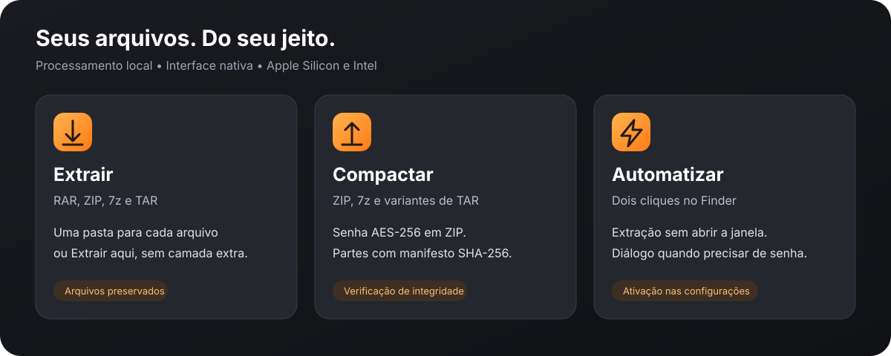
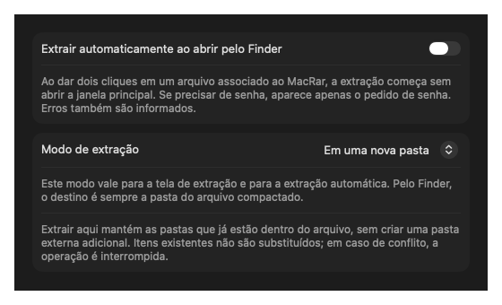

<p align="center">
  
</p>

<h1 align="center">MacRar</h1>
<p align="center">Extraia RAR no Mac. Crie ZIP, 7z e TAR com uma interface nativa.</p>
<p align="center">
  <a href="https://github.com/rafaelbazzolini/mac-rar/releases/latest"></a>
  
  
  <a href="LICENSE"></a>
  <a href="https://github.com/rafaelbazzolini/mac-rar/actions/workflows/ci.yml"></a>
</p>
<p align="center"><a href="docs/README.en.md">English</a> · <a href="https://github.com/rafaelbazzolini/mac-rar/releases/latest">Downloads</a> · <a href="docs/USAGE.md">Guia de uso</a> · <a href="https://github.com/rafaelbazzolini/mac-rar/issues">Reportar problema</a></p>

O MacRar é um aplicativo para macOS que extrai arquivos RAR, ZIP, 7z e outros formatos reconhecidos pela libarchive do sistema. Também cria arquivos compactados, protege ZIP com senha e permite extrair pelo Finder sem abrir a janela principal. Não exige Homebrew para funcionar nem instalação de ferramentas de compactação externas.

## Instalar

### Homebrew — Apple Silicon e Intel

O mesmo comando instala o build da arquitetura do seu Mac. Requer [Homebrew](https://brew.sh).

```sh
brew tap rafaelbazzolini/mac-rar https://github.com/rafaelbazzolini/mac-rar
brew install --cask rafaelbazzolini/mac-rar/mac-rar
```

Este é um tap próprio, hospedado neste repositório; o app não faz parte do catálogo oficial Homebrew Cask. A URL explícita no primeiro comando é necessária porque o repositório se chama `mac-rar`, sem o prefixo `homebrew-`.

Para atualizar ou remover:

```sh
brew update
brew upgrade --cask rafaelbazzolini/mac-rar/mac-rar
# Remover o aplicativo, preservando suas preferências:
brew uninstall --cask mac-rar
```

### Download direto

Baixe a versão correspondente na [release mais recente](https://github.com/rafaelbazzolini/mac-rar/releases/latest), extraia o ZIP e mova **MacRar.app** para **Aplicativos**.

| Mac | Arquivo da versão 2.1.0 |
| --- | --- |
| Apple Silicon — M1, M2 e posteriores | [MacRar-2.1.0-arm64.zip](https://github.com/rafaelbazzolini/mac-rar/releases/download/v2.1.0/MacRar-2.1.0-arm64.zip) |
| Intel | [MacRar-2.1.0-x86_64.zip](https://github.com/rafaelbazzolini/mac-rar/releases/download/v2.1.0/MacRar-2.1.0-x86_64.zip) |
| Integridade dos downloads | [SHA256SUMS.txt](https://github.com/rafaelbazzolini/mac-rar/releases/download/v2.1.0/SHA256SUMS.txt) |

**Requisitos:** macOS 13 Ventura ou superior; Apple Silicon ou Intel de 64 bits. Os dois builds são compilados para macOS 13. O build Intel é compilado cruzadamente; a execução em hardware Intel não foi validada nesta primeira publicação.

**Assinatura:** esta release usa assinatura local ad hoc e **não possui notarização da Apple**. O Gatekeeper pode bloquear a primeira abertura. Depois de conferir a origem do download, siga o procedimento de abertura em **Ajustes do Sistema → Privacidade e Segurança**, conforme o [guia da Apple](https://support.apple.com/pt-br/102445). O Homebrew não remove essa exigência do macOS.

## Veja o app



### Preferências de extração automática



O diagrama resume os recursos; a imagem de configurações é uma captura da interface real.

## Recursos

- Extrai RAR, ZIP, 7z, TAR e outros formatos reconhecidos pelo sistema.
- Extrai vários arquivos em sequência, com **uma pasta para cada arquivo** ou **Extrair aqui**.
- Extração automática pelo Finder, com janela de senha apenas quando necessária.
- Prévia do conteúdo com busca e teste de integridade sem extrair.
- Cria ZIP, 7z, TAR, TAR.GZ, TAR.BZ2 e TAR.XZ.
- Compressão rápida, equilibrada ou máxima; TAR simples não comprime.
- ZIP com senha AES-256 e confirmação; os nomes dos arquivos continuam visíveis.
- Divisão binária em partes de 10 MB, 100 MB, 700 MB ou 4 GB, com manifesto SHA-256.
- Verificação de integridade após criar, progresso e cancelamento cooperativo.
- Opção para incluir arquivos ocultos na compactação.
- Preserva arquivos existentes e recusa caminhos inseguros e links durante a extração.
- Processamento local, sem conta, anúncios ou chamadas de rede no código do aplicativo.

## Começar a usar

1. Abra o app e arraste um ou vários arquivos compactados.
2. Escolha o destino e o modo: **Em uma nova pasta** ou **Extrair aqui**.
3. Informe a senha, se houver, e clique em **Extrair arquivos**.

**Extrair aqui** mantém as pastas internas do arquivo, mas não cria uma pasta externa adicional. Se `material.zip` contém `material/foto.jpg`, o resultado é `material/foto.jpg`, sem a camada duplicada `material/material/foto.jpg`. Em caso de conflito de nomes, os arquivos existentes são preservados e a operação é interrompida.

Para extrair com dois cliques, associe o formato ao MacRar em **Finder → Obter Informações → Abrir com → Alterar Tudo…**. Depois ative **Extrair automaticamente ao abrir pelo Finder** na engrenagem do app ou em **MacRar → Configurações…** (`⌘,`). A opção vem desativada. Erros e conflitos ainda mostram um alerta.

Para compactar, selecione **Criar arquivo compactado**, adicione arquivos e pastas, escolha as opções e clique em **Criar arquivo…**.

Consulte o [guia de uso](docs/USAGE.md) para senhas, partes, configurações e solução de problemas.

## Formatos e limites

| Operação | Suporte |
| --- | --- |
| Extrair RAR/RAR5 | Depende do método e da versão da libarchive do macOS; não há garantia de todas as variantes |
| Extrair ZIP, 7z, TAR e filtros GZIP/BZIP2/XZ | Sim, conforme os métodos oferecidos pelo sistema |
| Extrair CPIO, CAB, ISO, XAR e outros | Conforme a versão da libarchive e o conteúdo |
| Criar ZIP e 7z | Sim |
| Criar TAR, TAR.GZ, TAR.BZ2 e TAR.XZ | Sim |
| Criar ZIP com AES-256 | Sim |
| Criar RAR ou 7z com senha | Não |
| Reparação, autoextraíveis e edição de arquivos compactados existentes | Não |
| Volumes RAR nativos e ZIP multipart | Sem suporte dedicado; as partes criadas pelo app são segmentos binários numerados |

O MacRar **não implementa todos os recursos do WinRAR** e não é afiliado ao WinRAR, RARLAB ou à Apple.

As partes `.001`, `.002`… devem ficar junto do arquivo `.parts.json`; abra a `.001` no MacRar para reunir, verificar e extrair. A reunião requer espaço temporário para o arquivo inteiro.

Links simbólicos, arquivos especiais e hard links na extração são recusados. Na compactação, hard links regulares são armazenados como cópias independentes. Permissões executáveis, ACLs, extended attributes e resource forks não são preservados. Os arquivos extraídos recebem permissões comuns. Não há cota de tamanho expandido: mantenha espaço disponível e não execute conteúdo desconhecido só porque passou no teste de integridade.

## Compilar e testar

Requer macOS e Xcode ou ferramentas de desenvolvimento com Swift 6. Não há dependências de pacotes externos.

```sh
git clone https://github.com/rafaelbazzolini/mac-rar.git
cd mac-rar
./scripts/build-app.sh                    # arquitetura atual → dist/MacRar.app
./scripts/build-app.sh arm64 dist/arm64   # Apple Silicon
./scripts/build-app.sh x86_64 dist/x86_64 # Intel, inclusive compilação cruzada
./scripts/package-release.sh             # os dois ZIPs e SHA256SUMS.txt
```

```sh
swift test --build-system native --disable-sandbox
python3 scripts/test-extraction.py
python3 scripts/test-compression.py
```

Há testes para extração e compactação, senha correta/incorreta, corrupção, arquivos ocultos, pastas vazias, conflitos, caminhos inseguros, cancelamento e partes com manifesto. Consulte [CONTRIBUTING.md](CONTRIBUTING.md) para reproduzir capturas e testar a abertura real pelo Finder.

## Projeto

- [Guia de uso](docs/USAGE.md) · [Guia de releases](docs/RELEASING.md)
- [Histórico de mudanças](CHANGELOG.md) · [Contribuir](CONTRIBUTING.md)
- [Segurança](SECURITY.md) · [Código de conduta](CODE_OF_CONDUCT.md) · [Suporte](SUPPORT.md)
- [Fontes SwiftUI](Sources/MacRar/) e [ponte C para libarchive](Sources/ArchiveBridge/)
- [Ícone original](Assets/AppIcon.png), criado com image_gen; [prompt de criação](Assets/IconPrompt.txt)

## Licença

[MIT](LICENSE). Copyright © 2026 Rafael Bueno Azzolini. Bibliotecas e frameworks do sistema mantêm suas respectivas licenças; o projeto não redistribui uma cópia da libarchive.
