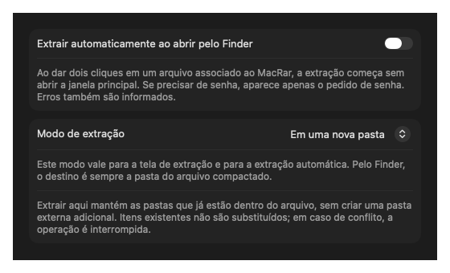

<p align="center"></p>

# MacRar

A native macOS archive utility. Extract RAR, ZIP, 7z and TAR, create archives, and optionally extract files opened in Finder without showing the main window.

[Português](../README.md) · [Download](https://github.com/rafaelbazzolini/mac-rar/releases/latest)

## Install

Requires macOS 13 Ventura or later. Separate native Apple Silicon (arm64) and Intel (x86_64) downloads are available in [Releases](https://github.com/rafaelbazzolini/mac-rar/releases/latest).

With [Homebrew](https://brew.sh), the same commands select the correct architecture:

```sh
brew tap rafaelbazzolini/mac-rar https://github.com/rafaelbazzolini/mac-rar
brew install --cask rafaelbazzolini/mac-rar/mac-rar
```

This repository is a custom tap, not an official Homebrew Cask listing. The explicit tap URL is required because its name does not start with `homebrew-`.

Alternatively, download the matching ZIP and move **MacRar.app** into **Applications**. Releases are ad-hoc signed and **not Apple-notarized**. Gatekeeper may require approval in System Settings → Privacy & Security; see [Apple's instructions](https://support.apple.com/en-us/102445). Homebrew does not bypass Gatekeeper. The Intel binary is cross-compiled and has not been tested on Intel hardware in this first release.

## Features

- Batch extraction with a separate folder per archive, or extraction directly into the destination.
- Optional automatic Finder extraction; passwords and errors are handled with dialogs.
- Archive contents browser, search and integrity checks.
- Create ZIP, 7z, TAR, TAR.GZ, TAR.BZ2 and TAR.XZ.
- Compression levels, AES-256 passwords for ZIP, optional hidden files and verification after creation.
- Numbered binary parts with a SHA-256 manifest.
- Cooperative cancellation and protection against overwriting existing files.
- Local processing with no account or network requests in the app code.




The interface and detailed guides are currently in Portuguese. The workflow image is an illustration; the settings image shows the actual interface.

## Usage

Drag archives into the extraction tab, choose the destination and extraction mode, then extract. **Extrair aqui** preserves the archive's internal directories but adds no outer folder.

To enable double-click extraction, associate each extension with MacRar in Finder → Get Info → Open with → Change All. Enable **Extrair automaticamente ao abrir pelo Finder** in MacRar's settings. This is disabled by default. Manual app launches still show the interface.

For numbered parts, keep `.001`, `.002`, etc. and `.parts.json` together and open `.001`. These are binary segments, not native RAR or multipart ZIP volumes. Joining requires temporary space for the whole archive.

## Limits

RAR variants and encryption depend on the macOS version of libarchive. MacRar does not create RAR, create encrypted 7z, repair archives, edit existing archives or produce self-extracting executables. It is not affiliated with WinRAR, RARLAB or Apple.

Existing files are not overwritten. Symbolic links, special files and archive hard links are rejected during extraction. Executable permissions, ACLs, extended attributes and resource forks are not preserved. There is no automatic expanded-size quota. Integrity checks do not establish that extracted content is safe to execute.

## Build and test

Requires macOS and Swift 6. No third-party Swift packages are required.

```sh
./scripts/build-app.sh
./scripts/build-app.sh arm64 dist/arm64
./scripts/build-app.sh x86_64 dist/x86_64
./scripts/package-release.sh
swift test --build-system native --disable-sandbox
python3 scripts/test-extraction.py
python3 scripts/test-compression.py
```

See [contributing](../CONTRIBUTING.md), [security](../SECURITY.md), [changelog](../CHANGELOG.md) and the [MIT license](../LICENSE).
