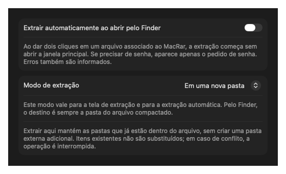

# Guia de uso

[← Voltar ao README](../README.md)

## Instalação e primeira abertura

Instale pelo Homebrew ou pela [release](https://github.com/rafaelbazzolini/mac-rar/releases/latest), conforme o [README](../README.md#instalar). Copie o app para Aplicativos antes de associar formatos. Não mantenha cópias antigas abertas para evitar confundir versões.

As releases atuais não são notarizadas pela Apple. Se o Gatekeeper bloquear a abertura, confira a origem do download e siga o [guia de abertura da Apple](https://support.apple.com/pt-br/102445). Não desative globalmente o Gatekeeper.

## Extrair arquivos

1. Abra **Extrair arquivos** e selecione ou arraste um ou vários arquivos.
2. O destino padrão é a pasta do arquivo original; use **Alterar…** para escolher outra.
3. Escolha **Em uma nova pasta** ou **Extrair aqui**.
4. Informe a senha se necessário e inicie a extração.
5. Use **Ver no Finder** após concluir.

Os itens são processados em sequência. Uma falha é mostrada no item correspondente. O cancelamento é cooperativo entre etapas e blocos de dados.

### Nova pasta ou Extrair aqui

- **Em uma nova pasta:** cada arquivo ganha uma pasta própria. Nomes existentes recebem sufixos como `(2)`.
- **Extrair aqui:** o conteúdo é publicado diretamente no destino, mantendo a estrutura interna. Diretórios existentes podem ser aproveitados; arquivos existentes não são substituídos. Em conflito, a operação é recusada.

Se um ZIP já contém uma pasta `material`, use Extrair aqui para evitar adicionar outra camada externa. A extração é preparada em staging privado; senha incorreta ou corrupção não deixam uma extração parcial publicada.

### Conteúdo e integridade

O botão de lista abre a prévia com busca, sem extrair. O escudo testa a leitura dos dados e detecta erros informados pelo mecanismo. A prévia exibe no máximo 100.000 entradas; a verificação percorre os dados reconhecidos. Um arquivo íntegro pode conter conteúdo malicioso.

## Extrair com dois cliques

1. No Finder, selecione um arquivo do formato desejado e use **Obter Informações**.
2. Em **Abrir com**, escolha MacRar e clique em **Alterar Tudo…**.
3. Repita por extensão, como RAR, ZIP e 7z.
4. Abra a engrenagem do MacRar e ative **Extrair automaticamente ao abrir pelo Finder**.
5. Escolha o modo de extração.

A configuração é persistente e começa desativada. Com ela ativa, a abertura pelo Finder extrai na pasta do arquivo original sem mostrar a janela principal. A senha aparece em um diálogo quando necessária. Erros ou conflitos geram um alerta com a opção de abrir a interface. Abrir o app diretamente continua exibindo a janela.

Se vários arquivos forem abertos juntos, eles entram em uma fila. O modo selecionado vale para todos, sem perguntar novamente por arquivo.



## Criar um arquivo compactado

1. Abra **Criar arquivo compactado**.
2. Adicione arquivos e/ou pastas.
3. Escolha ZIP, 7z, TAR, TAR.GZ, TAR.BZ2 ou TAR.XZ.
4. Escolha compressão rápida, equilibrada ou máxima; TAR simples apenas agrupa.
5. Se usar ZIP com senha, preencha e confirme a senha.
6. Configure partes, arquivos ocultos e verificação após criar.
7. Clique em **Criar arquivo…** e escolha um nome novo e o destino.

O destino não pode ficar dentro de uma pasta selecionada. Itens de origem com o mesmo nome devem ser renomeados antes de compactar. O app não apaga os originais.

### Senhas

ZIP usa AES-256. O conteúdo fica cifrado, mas nomes continuam visíveis. A compatibilidade com outros extratores depende do suporte a ZIP AES. A senha não é salva em preferências, logs, manifests nem argumentos de processos. Guarde-a: o aplicativo não possui recuperação de senha.

A criação de 7z com senha e RAR não está implementada. A extração de arquivos criptografados depende do suporte da libarchive do macOS ao método utilizado.

### Dividir em partes

Escolha 10 MB, 100 MB, 700 MB ou 4 GB. O resultado é composto por segmentos binários:

```text
Arquivo.zip.001
Arquivo.zip.002
Arquivo.zip.003
Arquivo.zip.parts.json
```

Mantenha todas as partes e o manifesto na mesma pasta. Abra `.001` no MacRar para reunir, verificar SHA-256 e extrair. O manifesto detecta partes finais ausentes e alterações. Sem manifesto, segmentos externos podem ser reunidos, mas não há garantia prévia de completude. O manifesto não é uma assinatura digital.

## Problemas comuns

| Problema | O que verificar |
| --- | --- |
| Ícone ou interface antiga | Feche cópias antigas e abra a versão instalada em Aplicativos. |
| Falta de permissão | Escolha uma pasta onde você possa gravar e confira o acesso do macOS a Documentos, Downloads ou volumes externos. |
| Item já existe | Use nova pasta ou outro destino; a operação não sobrescreve arquivos. |
| Senha incorreta | Confira maiúsculas e caracteres especiais; o método também pode não ser suportado pelo sistema. |
| Parte ausente ou SHA-256 inválido | Reúna novamente todas as partes e o `.parts.json` original. |
| Formato ou compressão não suportados | Confira se está na última versão do macOS e teste com um arquivo simples do mesmo formato. |
| Espaço insuficiente | A extração usa staging; partes exigem também espaço para reunir o arquivo completo. |

Se persistir, abra uma issue com versão, arquitetura e erro. Não publique documentos pessoais nem senhas. Consulte [SUPPORT.md](../SUPPORT.md).
